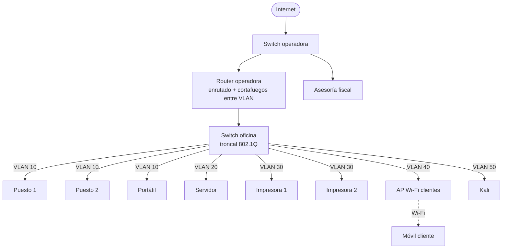

# Propuesta · La maldición de la gestoría (Mareas Asesores)

## 1. La red

### 1.1 Dibujo

Esquema visual

### 1.2 Qué separamos y por qué

No se compra hardware, así que usamos VLAN en el switch que ya hay y reglas en el router. Cinco segmentos:

| VLAN | Qué contiene | Por qué va separado |
|---|---|---|
| 10 Puestos | Puestos 1 y 2, portátil | Es el trabajo diario con datos de clientes. Es lo que hay que proteger. |
| 20 Servidor | Servidor | Concentra los datos. Solo lo alcanza quien lo necesita, y solo por los servicios necesarios. |
| 30 Impresoras | Impresoras 1 y 2 | Equipos con poco mantenimiento y sin autenticación; no deben ver ni ser vistos por el resto. |
| 40 Clientes | AP Wi-Fi y móviles de clientes | Red no confiable. Solo sale a Internet. |
| 50 Pruebas | Kali | Herramienta de pruebas. |

### 1.3 Reparto de direcciones

| Segmento y función | VLAN / interfaz | Red/prefijo | Rango utilizable | Puerta de enlace |
|---|---|---|---|---|
| Puestos y portátiles | VLAN 10 | 192.168.10.0/24 | .2 – .254 | 192.168.10.1 |
| Servidor | VLAN 20 | 192.168.20.0/27 | .2 – .30 | 192.168.20.1 |
| Impresoras | VLAN 30 | 192.168.30.0/27 | .2 – .30 | 192.168.30.1 |
| Wi-Fi clientes | VLAN 40 | 192.168.40.0/24 | .2 – .254 | 192.168.40.1 |
| Pruebas (Kali) | VLAN 50 | 192.168.50.0/29 | .2 – .6 | 192.168.50.1 |
| Salida a operadora | interfaz WAN | la que dé el operador | — | la del operador |

Justificación: Para los 40 usuarios, una subred /24 es suficiente, ya que permite conectar hasta 253 dispositivos con direcciones IP utilizables. Para los servidores e impresoras, al ser menos equipos, basta con una subred /27, que dispone de 30 direcciones utilizables. Los servidores y las impresoras tendrán IP fija o DHCP, mientras que los ordenadores y los dispositivos conectados por Wi-Fi recibirán su dirección IP automáticamente mediante DHCP.

### 1.4 Qué se permite y qué se bloquea

| Origen → Destino | Regla | Motivo |
|---|---|---|
| Clientes (40) → Internet | Permitir salida a internet | Es lo que busca un cliente en la sala de espera. |
| Clientes (40) → resto de VLAN | **Bloquear todo** | Un cliente no debe ver servidor, puestos ni impresoras. |
| Puestos (10) → Servidor (20) | Permitir solo los servicios necesarios | Trabajar con los datos sin abrir todo. |
| Puestos (10) → Impresoras (30) | Permitir solo impresión | Imprimir. |
| Puestos (10) → Internet | Permitir | Servicios externos. |
| Servidor (20) → Internet | Solo lo imprescindible, actualizaciones y copias | Reduce lo que un servidor comprometido puede hacer. |
| Impresoras (30) → cualquiera | **Bloquear** (solo respuestas) | Una impresora nunca inicia conexiones. |
| Pruebas (50) → producción | Bloquear salvo pruebas autorizadas | Evita que la herramienta sea un riesgo. |

---

## 2. Las medidas

### Medida 1: Segmentar la red en VLAN con reglas entre segmentos
- Qué problema resuelve y cómo lo sabemos: comparte una red plana y el AP de clientes llega al mismo switch.
- Qué hacemos: acotar
- Qué cambiamos y en qué equipo: switch oficina (VLAN y troncal), router (subinterfaces y reglas), AP (SSID de clientes en VLAN 40)
- A quién afecta: nadie en el trabajo diario, los clientes solo salen a Internet
- Cómo comprobaremos que protege y que la gestoría sigue trabajando: desde un móvil de la VLAN 40, el servidor y las impresoras no responden. Desde un puesto se abre el programa de gestión, se imprime y se navega.

### Medida 2: Aislar el Wi-Fi de clientes
- Qué problema resuelve y cómo lo sabemos: Acceso desde AP a la red interna, todo está en la misma red.
- Qué hacemos: Aislar el Ap de la red interna.
- Qué cambiamos y en qué equipo: AP wifi-clientes (SSID propio), router en VLAN 40
- A quién afecta: clientes
- Cómo comprobaremos: un móvil de cliente navega pero no ve a otros móviles ni a ningún equipo interno

